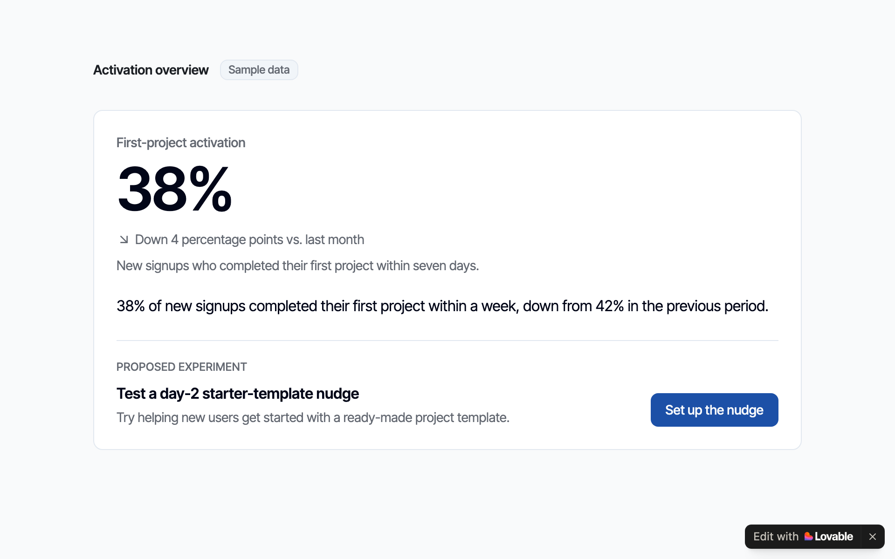

# Prototype v1: First Build (Lab 1)

> Module 1 · Velocity. Fifteen minutes from a vague problem to a clickable, shareable URL, instinct over methodology.

## Scenario

**Scenario 04: The Dashboard Nobody Reads.** The analytics product has a 60% bounce rate in the course scenario: the data is available, but users struggle to find an actionable insight. This prototype explores whether putting one headline metric, a plain-language takeaway, and one recommended next action on the first screen makes the next step clear.

## Launch path

- [ ] Copy & Customize (start from a scenario starter prompt)
- [x] First Screen Method (build only the very first screen the user sees)

## The build

- **What I built:** A first-screen analytics dashboard connecting one headline metric to a plain-language takeaway and a recommended next action. The initial build shows a sample 38% activation rate, defined as new signups who complete their first project within seven days, down four percentage points from the previous period. It proposes a day-2 nudge with a starter template. The numbers and proposed intervention are illustrative, not validated findings.
- **Tool used:** Lovable
- **Shareable link:** https://metric-moment-compass.lovable.app/

## Published screenshot

Captured directly from [the public dashboard](https://metric-moment-compass.lovable.app/) on November 3, 2026, at a 960 × 600 viewport with 2× resolution (1920 × 1200 PNG). The tighter framing makes the dashboard easier to read. The page loaded without a login and visibly labels its data as sample data.

The [original Lovable screenshot before the design refinement](assets/prototype-v1-before.png) is preserved for the before-and-after comparison.

## Show & Swap read

Feedback below is paraphrased from my peer's comments unless quoted.

- **What they understood immediately:** The dashboard connected an insight to an action. My peer expressed conditional interest in using it if it surfaced something actionable.
- **What confused them:** They questioned whether the insight and recommended action were meaningfully related or simply presented together. The dashboard was so minimal that they lacked context to judge whether it was the right action to take.
- **What assumption they thought it tested:** Connecting an insight to an action could make a dashboard useful and give someone a reason to use it.
- **What surprised them:** No separate comment about surprise was recorded.
- **The gap between what I intended and what they read:** I intended the metric, takeaway, and next action to make the decision clear. My peer understood that structure, but could not judge the reasoning behind the recommendation. Putting an action beside an insight did not, by itself, establish a convincing connection between them.

## What I learned

An actionable dashboard needs to explain why the proposed action follows from the insight. The next iteration should provide enough context to judge that connection while keeping the first screen focused. It should distinguish the observed signal from a possible explanation and a proposed experiment.

This is early feedback from one peer. Their conditional interest supports exploring the idea further; it does not establish that the recommendation is correct or that the dashboard will improve adoption.
