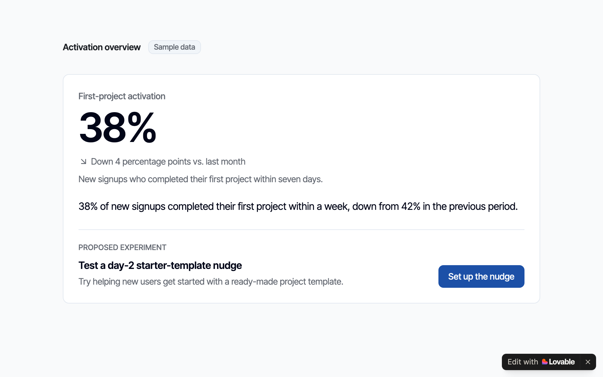
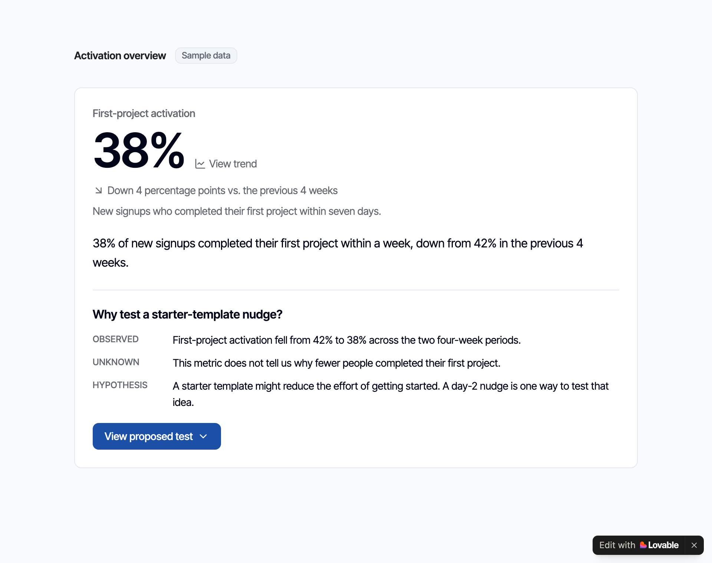

# Prototype v2: Two Upgrade Passes (Lab 2)

> Module 1 · Velocity. Same prototype, two surgical upgrade passes, closing the gap from toy to tool.

**Status:** Published early prototype using illustrative data.

**Scenario:** Scenario 04: The Dashboard Nobody Reads.

**Tool:** Lovable.

## Weakest section (from v1)

The recommended-action section. My first peer understood that the dashboard connected an insight to an action, but questioned whether the two were meaningfully related or simply presented together. The minimal screen did not provide enough context to judge whether the proposed action was appropriate.

The sample activation rate shows a decline, but it does not explain the cause or establish that a starter-template nudge will help. The next version should let someone inspect the metric and understand the reasoning behind the proposed experiment.

## Upgrade paths run

- [ ] Design Match
- [x] Add Interactivity
- [x] Surgical Refinement
- [ ] Existing Product Track

### Path B: Add Interactivity

**What changed:** The headline activation metric and a "View trend" button open an "Activation trend" side panel. It contains a weekly trend chart, a Last 4 weeks / Last 8 weeks filter, and the activated and eligible signup counts behind the selected period's rate. A close button and Escape return to the dashboard.

**Why:** A reader should be able to inspect the evidence behind the headline. The trend can show a decline; it cannot establish why the decline occurred.

**Sample data:** Activation means completing a first project within seven days of signup. The demo represents eight weekly signup cohorts with 200 eligible signups each. Activated signups, oldest to newest: 88, 84, 84, 80, 80, 78, 76, 70. The interface explicitly describes these as sample cohorts with completed seven-day observation windows; no real cohort history has been supplied.

- Latest four weeks: 304 / 800 = 38%.
- Previous four weeks: 336 / 800 = 42%.
- Change: down 4 percentage points.
- All eight weeks: 640 / 1,600 = 40%.

The homepage remains the latest four-week result. The filter changes the panel's chart and summary, with the selected period clearly labeled. All data is illustrative.

**Verified behavior:** The panel opens from both controls. The filter displays 38% and 304 / 800 for four weeks, then 40% and 640 / 1,600 for eight weeks. The chart changes with the range. The close button and Escape dismiss the panel. Verification covers this demo flow, not production analytics accuracy.

### Path C: Surgical Refinement

**What changed:** The recommended-action section now separates Observed, Unknown, and Hypothesis. "View proposed test" expands an inline experiment preview and changes to "Hide proposed test" to collapse it.

The preview identifies the intended audience, proposed intervention, comparison group, and outcome to measure:

- **Audience:** New signups who have not started a project by day 2.
- **Proposed intervention:** Offer a starter template in a day-2 reminder.
- **Comparison:** An equivalent group of eligible signups following the current experience.
- **Outcome:** First-project completion within seven days of signup.
- **Experiment status:** Proposed only; no results collected.

**Why:** This addresses the peer's concern that the insight and action might merely be presented together. It makes the rationale inspectable while keeping the proposed explanation and intervention explicitly unverified.

**Verified behavior:** The preview expands and collapses, contains the fields above, and states that the experiment is proposed with no results collected. This makes the proposal clearer, but does not establish that the nudge is the right intervention to prioritize.

## v2 build

- **v2 shareable link:** https://metric-moment-compass.lovable.app/
- **Before → after:** A static activation headline with limited context for its proposed action → an inspectable activation trend and an explained experiment preview. The prototype still lacks the surrounding evidence needed to diagnose the decline and justify a particular intervention.
- **What each pass changed:** Path B added the trend panel and time filter. Path C clarified the distinction between the signal, unknown cause, and proposed experiment, with expandable details.

### Before screenshot

The published v1 baseline, captured before the Lab 2 upgrades:

### After screenshot

Captured directly from the public URL on November 3, 2026, at a 960 × 760 viewport with 2× resolution. The overview and trend captures are 1920 × 1520 PNGs; the expanded preview uses a full-page capture to include all details.

Additional interaction evidence: [eight-week activation trend](assets/prototype-v2-trend.png) · [expanded proposed experiment](assets/prototype-v2-experiment.png) · [trend panel and proposed test open together](assets/prototype-v2-combined.png). The combined capture uses a wider viewport to show both sections; the trend panel's normal overlay dims the dashboard behind it.

### Published-build checks

- [x] Clicking the headline or "View trend" opens the panel; the close button and Escape return to the dashboard.
- [x] The time filter updates the chart and summary: 38% for the latest four weeks and 40% for all eight weeks.
- [x] The homepage comparison says "previous 4 weeks" and uses percentage points; the panel labels its selected period.
- [x] The interface labels the data as illustrative and describes the completed seven-day cohort window.
- [x] "View proposed test" expands and collapses the experiment preview.
- [x] The action section distinguishes the observed signal, unknown cause, and proposed experiment without claiming proven effectiveness.
- [x] The published URL opens without a login and shows the v2 changes.
- [x] The after screenshot and interaction evidence are saved and linked above.

## Show & Swap read, round 2

Feedback is paraphrased from the second peer discussion. My interpretation and proposed next steps are identified separately.

**1. Does this feel like a real product or just a visual mockup?**

It still feels like a mockup or early prototype. The added interactions expose more detail, but the dashboard does not yet provide enough context to support the recommended decision.

**2. Where did the interactivity fall short of expectations?**

The reader wanted to explore other metrics to understand whether activation was changing in isolation or alongside other signals. The time filter only changes the view of the same metric. It cannot help compare audience composition, marketing targeting, or possible product failures. No specific broken control was reported; the gap was the scope of investigation the interface supports.

**3. Would you show this to your VP as a credible solution? Why or why not?**

No explicit yes/no answer was recorded. The peer challenged the evidence for the recommendation: had a template existed eight weeks earlier, what had changed during that period, and why would those changes make a template the appropriate response? They raised possible changes in marketing targeting, audience composition, a broken product experience, or an existing template that had stopped working. These were alternative explanations to investigate, not established causes.

**My assessment:** I would show it as an early prototype to discuss what evidence is missing, but not yet as an evidence-backed solution to the activation decline.

## My synthesis and next iteration

I made the metric inspectable and the proposed experiment more transparent, but I still prioritized a starter-template nudge without evidence that starting effort was the main problem. A clearer explanation of a hypothesis does not establish that it is the best hypothesis to test. Eight weeks of illustrative data also does not show that an actual change occurred eight weeks ago.

The next iteration should help the user diagnose what changed before presenting one intervention as the default. I would keep the headline screen focused and add a compact investigation view with these comparisons:

| Proposed addition | What the user could inspect | Decision it would support |
| --- | --- | --- |
| Audience and acquisition mix | Signup volume, channel/campaign share, and activation within each segment over the same periods | Check whether the overall rate moved because the audience mix changed or because activation fell within comparable groups. |
| Activation funnel | Counts and conversion through signup, editor opened, project started, and first project completed | Locate where progress declined before choosing an intervention aimed at that step. |
| Product health and change history | Editor/create/save error rates by browser or device, alongside release dates | Investigate whether a technical regression coincides with the drop and warrants a fix. |
| Template availability and use | Whether a template existed, when it changed, exposure/use rates, and outcomes for comparable cohorts | Establish whether a template is new, underused, or possibly failing before proposing another template nudge. |

These are proposed improvements, not features or findings in v2. Segment differences and coincident events would guide investigation; they would not establish causation on their own. Template users may also differ from non-users, so a simple comparison would not prove a template effect.

**Next decision:** Choose between further diagnosis, a product fix, or a controlled intervention after reviewing those signals. Keep the nudge as one candidate, rather than treating it as the demonstrated answer.
