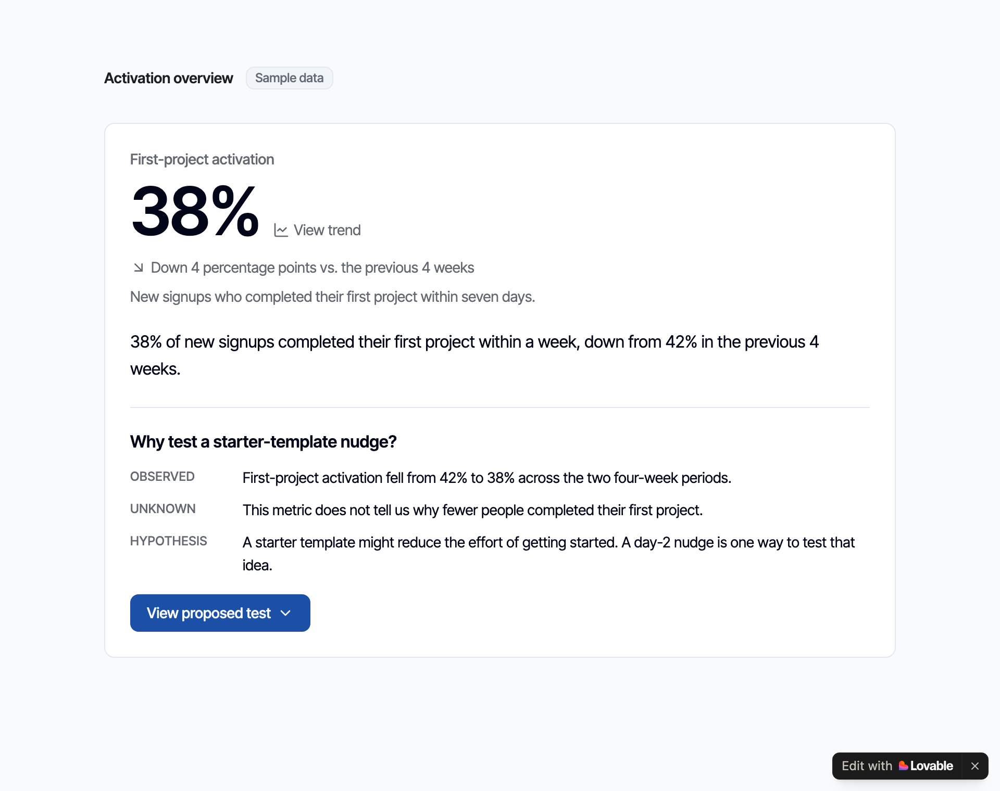
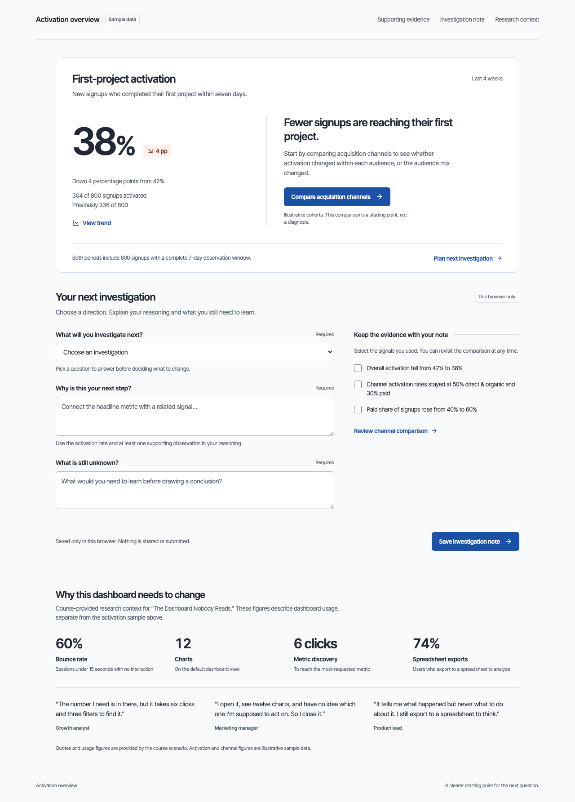

# Prototype (v3): The Build That Tests the Hypothesis

> Module 2 · Validation. The prototype is a hypothesis test, not a demo.

**Status:** Built, checked, and published November 5, 2026. Reviewed by a Codex subagent on November 5. Feedback and the resulting iteration decision are recorded in [show-and-swap-notes.md](show-and-swap-notes.md).

## Link

[Open the Module 2 prototype](https://metric-moment-compass.anajuana.chatgpt.site/)

[Open the preserved Module 1 v2 comparison](https://metric-moment-compass.anajuana.chatgpt.site/module-1/).

**Workflow adaptation:** The lab asks for a fresh project to preserve the M1↔M2 comparison. I used Codex and Sites, kept M1 on its own route and in Sites version 1, and published lab v3 as Sites version 2 in the same Site. This preserves the comparison but is not a separate fresh project. The existing M1 build supplied the visual reference. Application source stays in Sites' repository; this course repository contains the written artifacts and screenshot evidence.

## What it tests

Whether a first screen with one headline metric, a plain-language takeaway, and a clear path to supporting context helps product leads investigating a drop in first-project activation choose and explain a sensible next investigation without exporting to a spreadsheet or needing help.

The success criterion from the [validation brief](validation-brief.md) is that, after a three-minute unaided walkthrough, a new peer can name a next investigation, support it with the headline and at least one related signal, and identify what remains unknown. The recorded review surfaced all three reasoning elements and a concern about prewritten answer cues. It does not establish an overall hypothesis pass.

## Context injected (no placeholders)

- **Real user quotes on screen (supplied by the course):**
  - “The number I need is in there, but it takes six clicks and three filters to find it.” — Growth analyst
  - “I open it, see twelve charts, and have no idea which one I'm supposed to act on. So I close it.” — Marketing manager
  - “It tells me what happened but never what to do about it. I still export to a spreadsheet to think.” — Product lead
- **Domain metrics on screen (course scenario baselines):**
  - **60%** bounce rate: sessions under 15 seconds with no interaction.
  - **12** charts on the default landing view.
  - **6 clicks** to reach the most-requested metric.
  - **74%** of users export to a spreadsheet to analyze.
- **Provenance:** These quotes and dashboard metrics come from the course's Context Data Pack. They are not interviews or usage measurements collected from this prototype.
- **Illustrative activation data:** First-project activation means completing a first project within seven days of signup. Both four-week periods include completed observation windows. The headline falls from 336/800 = 42% to 304/800 = 38%, a decrease of 4 percentage points.

The supporting acquisition comparison uses the same eligible signups and reconciles to that headline:

| Signal | Previous four weeks | Latest four weeks |
| --- | --- | --- |
| Direct/organic activation | 240/480 = 50% | 160/320 = 50% |
| Paid activation | 96/320 = 30% | 144/480 = 30% |
| Paid share of signups | 320/800 = 40% | 480/800 = 60% |
| Overall activation | (240 + 96)/800 = 42% | (160 + 144)/800 = 38% |

This constructed example makes audience mix worth investigating. It does not establish a cause in a real product or show that a template nudge will help.

## Core flow

Headline → acquisition-channel comparison → a next-investigation note.

The implemented interaction includes a channel filter, the retained four/eight-week trend panel, and a note with an investigation choice, cited evidence, reasoning, and remaining uncertainty. Notes stay in the visitor's browser. They do not create work in an external system or launch an experiment.

## Iteration log (v1 → v3)

| Version | Change | Why |
|---|---|---|
| v1 | Built a focused first screen with a 38% activation headline, a plain-language takeaway, and a proposed day-2 starter-template nudge. | Test whether connecting one insight to one action makes the dashboard useful. Peer feedback showed that the connection needed more supporting context. |
| v2 | Added a clickable activation trend with four/eight-week filters, an expandable proposed test, and separate Observed, Unknown, and Hypothesis statements. | Let users inspect the metric and understand the proposed experiment. Peers still questioned why a template nudge was the right response and wanted related metrics and audience context. |
| v3 | Added a filterable acquisition-channel comparison and a locally saved investigation note for the user's chosen investigation, evidence, reasoning, and remaining uncertainty. Put all three selected quotes and four course metrics on screen. | Test whether supporting context helps users choose and justify their own next investigation. This addresses the peer's audience-mix question while keeping the cause and appropriate intervention open to investigation. |

**Review-driven next iteration, proposed:** Remove the investigation note’s prewritten evidence answers from the initial view, so they do not reveal the comparison before the reader explores it. Retest whether the reader can explain the evidence in their own words. The reviewer also requested campaign-level drill-down; that requires additional data. These changes are not implemented in the published v3. See the [feedback and decision](show-and-swap-notes.md).

## Screenshots

The M1 image was captured from the published v2 build. The M2 images were captured from the final production build before publication.

| Module 1: inspect a proposed action | Module 2: choose an investigation using context |
| --- | --- |
|  |  |

Additional views: [supporting evidence expanded](assets/prototype-v3-supporting-evidence.png) · [mobile](assets/prototype-v3-mobile.png).

## Verification and peer evidence

Functional checks passed before publication: 17 tests, TypeScript, and the production build. Browser checks covered the channel comparison/filter, four/eight-week trend, note validation, saving/reloading, editing, and clearing. Desktop and 390px mobile screenshots were reviewed, including long-text wrapping. Both public routes were published successfully.

These checks establish that the testable flow works. They do not establish that users can reason from it. The example data and guided comparison test comprehension of prepared evidence; they do not measure reduced bounce, reduced spreadsheet use at work, or improved activation.

**Peer review and decision:** Recorded in [show-and-swap-notes.md](show-and-swap-notes.md). The reviewer connected the headline to channel mix and named relevant unknowns, but flagged that the interface supplied the expected reasoning. Decision: revise the evidence-to-reasoning flow and retest. The [validation brief](validation-brief.md) remains the decision rule; no overall usability pass is claimed.

Build reference: lab v3 is Sites version 2, source commit `a6ddd87b5c1c99c510579782c3ea3da9426df3c1`. M1 remains available on `/module-1/` and in Sites version 1.
