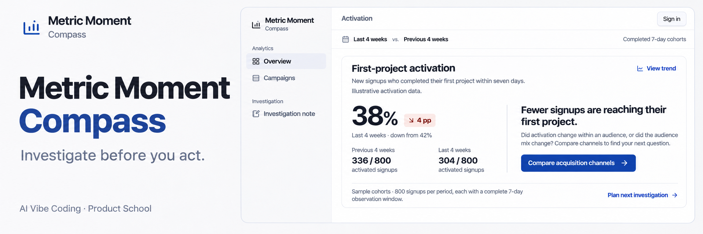

[](https://antje.github.io/product-school-vibe-coding/)

# Metric Moment Compass

> **Metric Moment Compass:** help a product lead investigate an activation decline with enough context to explain the next step.

My final project for Product School's **AI Vibe Coding** certification follows **Scenario 04: The Dashboard Nobody Reads**, locked for Modules 2–6.

The first prototype proposed a starter-template nudge before explaining the activation decline. Peer feedback changed the product bet: help the reader investigate before choosing an intervention. The current build connects an activation headline to channel and campaign evidence, private saved notes, and a copyable investigation summary.

- **The bet:** A focused activation headline plus accessible supporting evidence helps a product lead choose a next investigation, explain the evidence, and identify what remains unknown without spreadsheet export or coaching.
- **Try the product:** [Live version 8](https://metric-moment-compass.anajuana.chatgpt.site/) · [preserved Module 1 prototype](https://metric-moment-compass.anajuana.chatgpt.site/module-1/).
- **See the story:** [Final presentation](https://antje.github.io/product-school-vibe-coding/), published on GitHub Pages. A [self-contained HTML copy](final-presentation.html) is also included.
- **Evidence today:** [158 automated tests and successful summary-copy checks](06-iteration/iteration.md) support the implementation. [19 live database checks](05-fullstack/fullstack.md) support persistence and account isolation. Course baselines, illustrative analytics, and qualitative review are kept separate from product-usage evidence.
- **Decision: Iterate.** The guest demo and confirmed-account flows work. Broad signup remains a no-ship until confirmation-email delivery is verified. The usability hypothesis has not passed a human study.
- **Biggest unknown and next test:** Can a product lead explain a defensible investigation without coaching? M3 removed premature answer cues. Before prioritizing another feature, Antje will run the [three-minute test and its three fixed criteria](02-validation/validation-brief.md#kill-switch) with a fresh representative product lead. Any failed criterion sends that step back for revision.

This repository holds the course write-ups, screenshot evidence, and share links.

---

## Deliverables at a glance

| # | Module | Deliverables | Status | Folder |
|---|---|---|---|---|
| 1 | **Velocity** | [v1](01-velocity/prototype-v1.md) · [v2](01-velocity/prototype-v2.md) · [reflection](01-velocity/confidence-line-reflection.md) | Complete, including both peer reads | `01-velocity/` |
| 2 | **Validation** | [brief](02-validation/validation-brief.md) · [v3](02-validation/prototype-v3.md) · [peer notes](02-validation/show-and-swap-notes.md) | Brief, build, and review feedback recorded; next iteration proposed | `02-validation/` |
| 3 | **Prompt Chaining** | [Living Prompt Pack](03-chaining/PROMPTS.md) · [design prompts](03-chaining/design-v4/DESIGN-PROMPTS.md) · [results and screenshots](03-chaining/design-v4/RESULT.md) | Chain executed, verified, and reflected on. A class-peer prompt read is not recorded. | `03-chaining/` |
| 4 | **Production Specs** | [Living PRD](04-production/PRD.md) · [engineering handoff](04-production/handoff-note.md) | PRD and handoff complete. Refactor and Supabase verified. | `04-production/` |
| 5 | **Full-Stack** | [Data, access rules, edge cases, and deploy](05-fullstack/fullstack.md) · [deck sections](05-fullstack/deck-sections.md) | Labs 1–2 recorded and published. Offline recovery and five-click saving passed. Signup email delivery remains a known gap. | `05-fullstack/` |
| 6 | **Evals & Iteration** | [Evidence and recommendation](06-iteration/iteration.md) · [sprint brief](06-iteration/iteration-sprint-brief.md) · [final presentation](https://antje.github.io/product-school-vibe-coding/) | Copy summary verified and published. Showcase published on GitHub Pages. Decision: Iterate. User validation remains open. | `06-iteration/` |

## My scenario

**Chosen scenario:** Scenario 04, The Dashboard Nobody Reads. Locked November 5, 2026.

**Primary risk:** Usability. A product lead sees a fall in first-project activation but needs related signals to decide what to investigate. The prototype tests that decision-making task. It does not test whether a template nudge improves activation.

## The three ingredients

1. **Hypothesis:** The specific usability bet and observable pass/fail rule in the [validation brief](02-validation/validation-brief.md).
2. **Domain data:** Four course-provided dashboard baselines in [Research context](https://metric-moment-compass.anajuana.chatgpt.site/research/), separate from illustrative activation and channel data.
3. **User voice:** Three verbatim course-provided quotes in Research context. Their design implications remain in the [validation brief](02-validation/validation-brief.md#the-three-ingredients).

___

## How to submit

Submit both items in the Learning Platform's **Upload Your Vibe Coding Final Project** section:

1. **Repository:** https://github.com/antje/product-school-vibe-coding. The live product link and six modules of evidence are included here.
2. **Presentation:** https://antje.github.io/product-school-vibe-coding/. You can also download and upload [final-presentation.html](final-presentation.html). The HTML contains its images and works without an internet connection. Product and evidence links require internet access. GitHub Pages serves the identical copy at [docs/index.html](docs/index.html).

The presentation supports previous/next controls, arrow keys, a reading view, and printing. The repository and presentation are public, so reviewers can open both without signing in. Submit within **7 days of the cohort ending** to receive written instructor feedback. This repository does not establish the cohort's end date or confirm Learning Platform submission.

## Repo structure

```
product-school-vibe-coding/
├── README.md                       ← this dashboard
├── final-presentation.html         ← self-contained presentation for submission
├── docs/index.html                 ← identical GitHub Pages presentation
├── 01-velocity/
│   ├── prototype-v1.md             ← M1 Lab 1: first build + Show & Swap read
│   ├── prototype-v2.md             ← M1 Lab 2: two upgrade passes (toy → tool)
│   └── confidence-line-reflection.md ← M1: optional reflection
├── 02-validation/
│   ├── validation-brief.md         ← M2: hypothesis · risk · kill switch
│   ├── prototype-v3.md             ← M2: the build that tests it
│   └── show-and-swap-notes.md      ← M2: peer feedback
├── 03-chaining/
│   └── PROMPTS.md                  ← M3: the Living Prompt Pack
├── 04-production/
│   ├── PRD.md                      ← M4: living PRD
│   └── handoff-note.md             ← M4: engineering handoff
├── 05-fullstack/
│   └── fullstack.md                ← M5: data, access rules, edge cases, deploy link
└── 06-iteration/
    └── iteration.md                ← M6: analytics + go/iterate/kill recommendation
```
